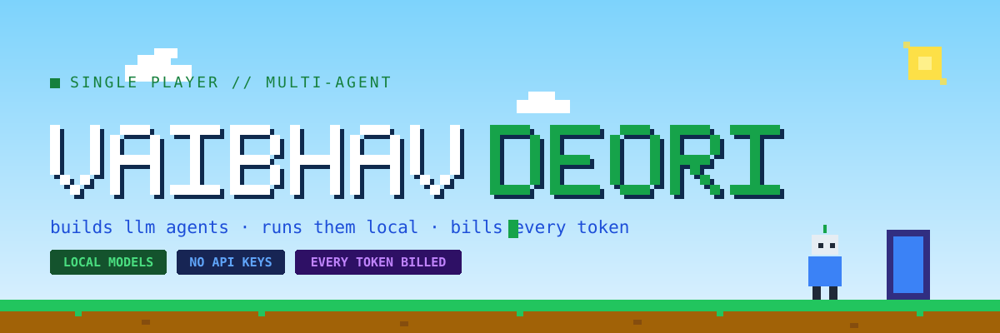
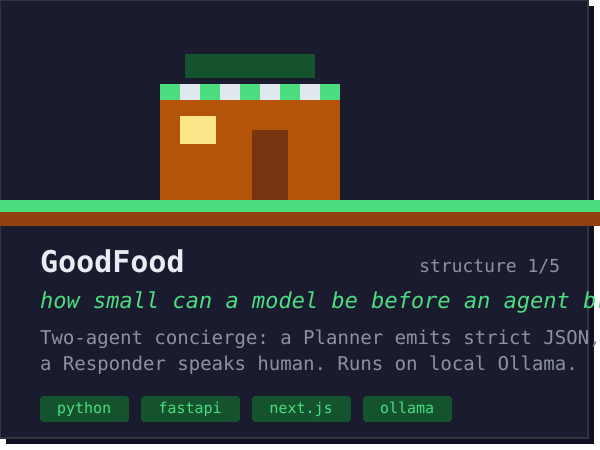
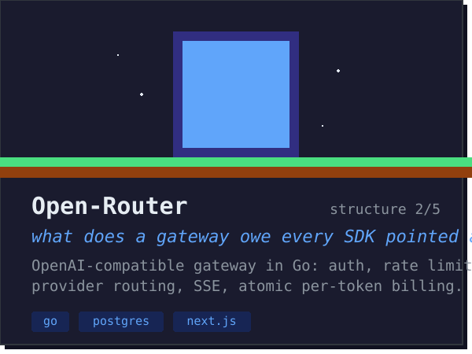
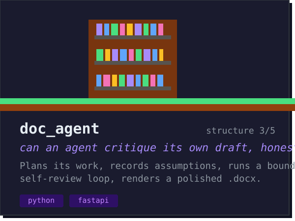
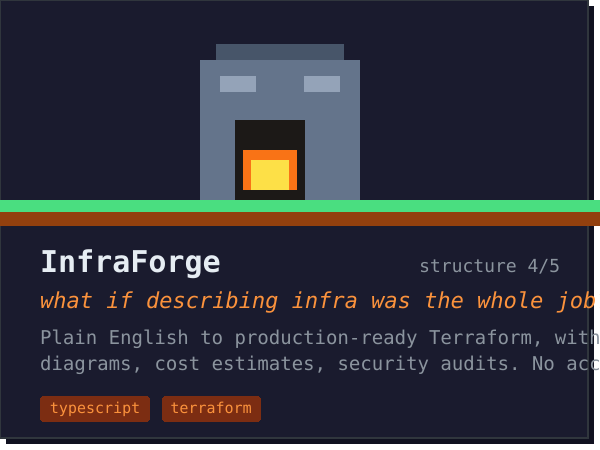
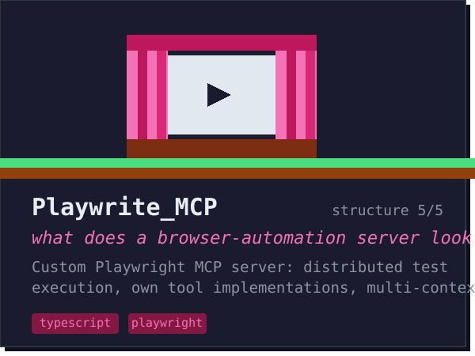

<a href="https://github.com/DreViz">
  <picture>
    <source media="(prefers-color-scheme: dark)" srcset="hero_dark.svg">
    
  </picture>
</a>

<picture>
  <source media="(prefers-color-scheme: dark)" srcset="sec_player_dark.svg">
  
</picture>

Backend engineer in Bangalore. I build the systems under LLM agents —
gateways, routing, per-token billing — and the agents themselves, which
plan, call tools, and review their own output on hardware I control.

I like systems with real constraints. No customer data leaving the machine.
Every token accounted for. Most builds below started as a question I
couldn't answer by reading — so I built the answer.

<picture>
  <source media="(prefers-color-scheme: dark)" srcset="sec_quest_dark.svg?v=2">
  
</picture>

Current quests: going deeper on **Go**, agent evaluation, MCP tooling.

Open to backend/AI roles — Bangalore or remote.

<picture>
  <source media="(prefers-color-scheme: dark)" srcset="sec_builds_dark.svg">
  
</picture>

<table>
  <tr>
    <td></td>
    <td></td>
  </tr>
  <tr>
    <td></td>
    <td></td>
  </tr>
  <tr>
    <td></td>
    <td></td>
  </tr>
</table>

<picture>
  <source media="(prefers-color-scheme: dark)" srcset="sec_inv_dark.svg">
  
</picture>

<picture>
  <source media="(prefers-color-scheme: dark)" srcset="inv_dark.svg?v=2">
  
</picture>

Python · Go · JavaScript · TypeScript · Node.js · FastAPI · Next.js ·
PostgreSQL · Ollama · MCP · Playwright · Manim · Docker

<picture>
  <source media="(prefers-color-scheme: dark)" srcset="sec_xp_dark.svg">
  
</picture>

<picture>
  <source media="(prefers-color-scheme: dark)" srcset="xp_dark.svg">
  
</picture>

<!-- Uncomment and fill in when ready:
### Elsewhere

[linkedin](https://www.linkedin.com/in/YOUR-HANDLE) · [resume](LINK-TO-RESUME) · YOUR-EMAIL@example.com
-->
