<a href="https://github.com/DreViz">
  <picture>
    <source media="(prefers-color-scheme: dark)" srcset="hero_dark.svg">
    
  </picture>
</a>

<picture>
  <source media="(prefers-color-scheme: dark)" srcset="ticker_dark.svg">
  
</picture>

<picture>
  <source media="(prefers-color-scheme: dark)" srcset="hdr_who_dark.svg">
  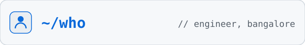
</picture>


Engineer in Bangalore. I build LLM agents that earn their keep: they plan,
call tools, review their own output, and run on hardware I control. When the
model isn't the hard part, I build what's around it — gateways, routing,
per-token billing.

I like systems with real constraints. No customer data leaving the machine.
Every token accounted for. Most repos below started as a question I couldn't
answer by reading — so I built the answer.

<picture>
  <source media="(prefers-color-scheme: dark)" srcset="hdr_now_dark.svg">
  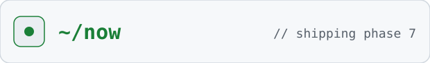
</picture>

Shipping **[GoodFood](https://github.com/DreViz/GoodFood)** phase 7:
deployment, walkthrough video, and the writeup of the 4 GB model-selection
measurements. Going deeper on **Go**, agent evaluation, and MCP tooling.

Open to AI/backend roles — Bangalore or remote.

<picture>
  <source media="(prefers-color-scheme: dark)" srcset="hdr_building_dark.svg">
  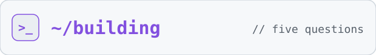
</picture>

<table>
  <tr>
    <td><a href="https://github.com/DreViz/GoodFood"></a></td>
    <td><a href="https://github.com/DreViz/Open-Router"></a></td>
  </tr>
  <tr>
    <td><a href="https://github.com/DreViz/doc_agent"></a></td>
    <td><a href="https://github.com/DreViz/Infra4rge"></a></td>
  </tr>
  <tr>
    <td><a href="https://github.com/DreViz/Playwrite_MCP"></a></td>
    <td></td>
  </tr>
</table>

<picture>
  <source media="(prefers-color-scheme: dark)" srcset="hdr_earlier_dark.svg">
  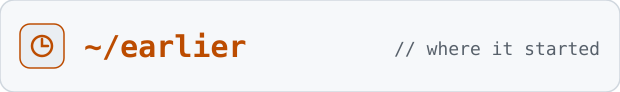
</picture>

Where the questions started. Manim animations, sentiment analysis, stocks,
a music API. Kept for the record.

<picture>
  <source media="(prefers-color-scheme: dark)" srcset="hdr_stack_dark.svg">
  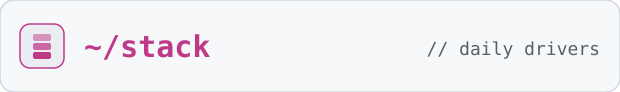
</picture>

| | |
|---|---|
| **Languages** | Python · Go · TypeScript · JavaScript |
| **AI/LLM** | Ollama · qwen3 · multi-agent · tool calling · self-review loops · MCP |
| **Backend** | FastAPI · Next.js · REST · SSE streaming |
| **Data** | PostgreSQL |
| **Tooling** | Playwright · Manim · Docker |

<picture>
  <source media="(prefers-color-scheme: dark)" srcset="hdr_languages_dark.svg">
  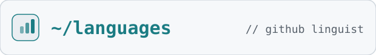
</picture>

<picture>
  <source media="(prefers-color-scheme: dark)" srcset="langs_anim_dark.svg">
  
</picture>

<!-- Uncomment and fill in when ready:
### Elsewhere

[linkedin](https://www.linkedin.com/in/YOUR-HANDLE) · [resume](LINK-TO-RESUME) · YOUR-EMAIL@example.com
-->
